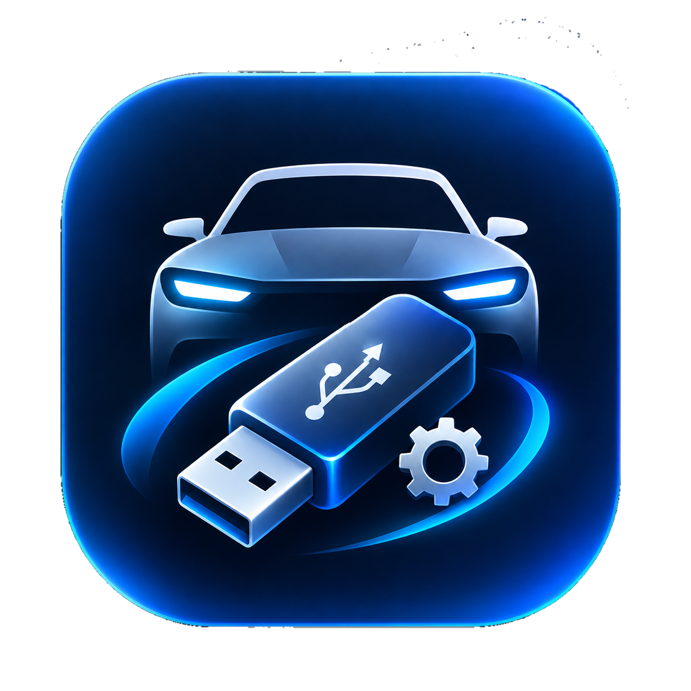

<div align="center">



# AutoUSB Toolkit

**Open-source USB optimizer for car stereos & infotainment systems.**

[](https://github.com)
[](src/)
[](LICENSE)
[](https://github.com)
[](https://github.com)
[](https://github.com)

<br />

<kbd>Format & Prep</kbd> · <kbd>Music Sync</kbd> · <kbd>Drive Doctor</kbd> · <kbd>FAT Sorter</kbd> · <kbd>Car Profiles</kbd>

<br />

> Tired of your car stereo saying **"Unsupported USB"**, skipping tracks, or playing songs in random order?<br />
> AutoUSB Toolkit fixes all of that — in one click.

<br />

[**Download .exe**](bin/AutoUSB-Toolkit.exe) &nbsp;·&nbsp; [Indian Car Brands](#-indian-car-brand-coverage) &nbsp;·&nbsp; [Build from Source](#-build-from-source) &nbsp;·&nbsp; [Safety](#-safety)

</div>

<br />

---

<br />

## The Problem

Car stereos run embedded firmware with strict hardware rules that Windows ignores:

| What Windows Does | What Your Car Needs | AutoUSB Fix |
|:---|:---|:---|
| Forces NTFS/exFAT on >32 GB | FAT32 (always) | Formats up to **2 TB** as FAT32 |
| Leaves GPT partition table | MBR (Master Boot Record) | 1-click GPT → MBR conversion |
| Uses 4 KB clusters | 32 KB clusters | Automotive-tuned allocation |
| Random FAT directory order | Sequential track order | FATSort physical reordering |
| Leaves `.DS_Store`, `._*` junk | Clean filesystem | Drive Doctor purges all trash |
| ID3v2.4 tags freeze displays | ID3v2.3 safe tags | Auto-converts tags & album art |

<br />

---

<br />

## Features

### ⚡ Format & Prep
- **Direct FAT32 Engine** — breaks the Windows 32 GB barrier, formats 64/128/256 GB+ drives
- **MBR Enforcer** — converts GPT → MBR so your head unit actually mounts the drive
- **32 KB Cluster Tuning** — prevents audio stutter and buffer underruns
- **Volume Label Sanitizer** — safe 11-char uppercase ASCII labels (e.g. `CAR_USB`)

### ♫ Music Sync
- **Filename Sanitizer** — strips `[ ] # % & +` emojis and Unicode that cause skips
- **ID3 Tag Normalizer** — converts ID3v2.4 → ID3v2.3 (UTF-16 / ISO-8859-1)
- **Album Art Optimizer** — resizes to 500x500 baseline JPEG
- **Folder Organizer** — preserve structure, auto-sort by artist/album, or batch by limits

### ⊘ Drive Doctor
- **Full Audit** — scans for GPT bugs, small clusters, hidden OS trash, illegal characters
- **1-Click Clean** — removes `._*`, `.DS_Store`, `.Trashes`, `Thumbs.db` and more

### ↕ FAT Sorter
- Car stereos read files in **physical FAT directory order**, not alphabetically
- FATSort rewrites directory entries so albums play `01 → 02 → 03` correctly

### ◉ Car Profiles Database
- **65+ verified presets** — select your car brand and model, all settings auto-configure
- **34+ Indian market profiles** — Maruti, Tata, Mahindra, Hyundai, Kia, and more

<br />

---

<br />

## UI

Linear-inspired minimalist dark interface:

- Obsidian palette — `#101114` sidebar, `#16171B` canvas, `#23252C` borders
- `#5E6AD2` indigo accent throughout
- Custom dark ComboBox, ListBox, ScrollBar, and Button controls
- Embedded app icon in exe, title bar, taskbar, sidebar, and status bar
- Zero chunky native Windows controls

<br />

---

<br />

## 🇮🇳 Indian Car Brand Coverage

34+ verified profiles covering every major manufacturer in India:

| Brand | Head Unit / Platform | Popular Models |
|:---|:---|:---|
| **Maruti Suzuki** | SmartPlay Pro+ 9" / Pro 7" / Studio / Dock | Grand Vitara, Baleno, Brezza, Swift, WagonR, Dzire, Ertiga |
| **Tata Motors** | Harman Cinematic 10.25"/12.3" / 7" Touch | Harrier, Safari, Nexon, Curvv, Punch, Altroz, Tiago |
| **Mahindra** | AdrenoX AI Dual 10.25" (Sony 3D) / 7"-9" | XUV700, Scorpio-N, Thar Roxx, XUV 3XO, Bolero |
| **Hyundai India** | AVN Display Audio (Bose) | Creta, Venue, Verna, i20, Alcazar, Tucson, Exter |
| **Kia India** | Dual Panoramic AVNT (Bose) | Seltos, Sonet, Carens, Carnival, EV6 |
| **Toyota Kirloskar** | Audio Multimedia 10.1" / 8" | Innova Hycross, Fortuner, Hyryder, Glanza |
| **Honda Cars India** | Advanced Display Audio 8" / 7" | Elevate, City, Amaze |
| **Volkswagen India** | VW Play 10.1" | Taigun, Virtus, Tiguan |
| **Skoda India** | Skoda Play 10" / 8" | Kushaq, Slavia, Kodiaq, Kylaq |
| **MG Motor India** | i-SMART 14" Portrait / 10.1" | Hector, Astor, ZS EV, Windsor EV |
| **Renault India** | MediaNAV / EasyLink 8" | Kiger, Triber, Kwid |
| **Nissan India** | NissanConnect 8" | Magnite, X-Trail |
| **Citroen India** | My Citroen Play 10.2" / 7" | Basalt, C3, C3 Aircross |
| **Force Motors** | Touchscreen Infotainment | Gurkha, Urbania |
| **Jeep India** | Uconnect 5 10.1" (Alpine) | Compass, Meridian, Wrangler |
| **BYD India** | DiLink (Dynaudio) | Atto 3, Seal, eMAX 7 |
| **Isuzu India** | Touchscreen Infotainment | D-Max V-Cross, MU-X |
| **BMW India** | iDrive 7/8/9 (Harman/B&W) | 3 Series, 5 Series, X1, X3, X5 |
| **Mercedes-Benz India** | MBUX NTG 6/7 (Burmester) | C-Class, E-Class, GLA, GLC, GLS |
| **Audi India** | MMI Touch / MIB 3 | A4, A6, Q3, Q5, Q7 |
| **Volvo India** | Google Built-in Android Auto | XC40, XC60, XC90, C40 |
| **Land Rover India** | Pivi Pro 11.4" | Defender, Range Rover, Velar |
| **Lexus India** | Lexus Interface (Mark Levinson) | ES, NX, RX, LX |
| **Porsche India** | PCM 6.0 (Burmester/Bose) | Macan, Cayenne, 911, Taycan |
| **Mini India** | Mini Connected OLED | Cooper S, Countryman |

Also includes: **Blaupunkt India**, **Nippon Audiotronics**, **Woodman India**, **Indian Android Decks** (Hypersonic, DHC, UIS7862), and **Pioneer / Sony / Alpine** aftermarket.

<br />

---

<br />

## 🔧 Build from Source

No Visual Studio needed. Any Windows 10/11 system has the built-in C# compiler.

**Option 1 — Batch script:**
```cmd
build.bat
```

**Option 2 — PowerShell:**
```powershell
.\build.ps1
```

**Option 3 — MSBuild / Visual Studio:**
```cmd
msbuild AutoUSB-Toolkit.sln /p:Configuration=Release
```

Output: `bin\AutoUSB-Toolkit.exe` (~1.4 MB standalone, zero external DLLs)

<br />

---

<br />

## 🛡️ Safety

| Safeguard | Description |
|:---|:---|
| **System Disk Lock** | `C:\` and internal recovery partitions are hidden and locked by default |
| **Double Confirmation** | Shows target drive letter, label, and partition layout before any format |
| **Non-Destructive Tools** | Music Sync, Drive Doctor, and FAT Sorter never repartition or wipe data |

<br />

---

<br />

## Project Structure

```
AutoUSB-Toolkit/
├── src/
│   ├── Core/
│   │   ├── AudioOptimizer.cs     # ID3 tag normalization & album art
│   │   ├── CarDatabase.cs        # 65+ verified car profiles
│   │   ├── DiskFormatter.cs      # FAT32 format & MBR enforcement
│   │   ├── DriveDetector.cs      # USB drive detection & enumeration
│   │   ├── DriveDoctor.cs        # Audit & junk file removal
│   │   ├── Fat32Engine.cs        # Direct FAT32 formatting engine
│   │   ├── FatSorter.cs          # Physical FAT directory reordering
│   │   ├── Logger.cs             # Application logging
│   │   └── MediaSyncEngine.cs    # Music sync & filename sanitizer
│   ├── Models/
│   │   ├── AuditResult.cs        # Drive audit result model
│   │   ├── CarProfile.cs         # Car profile data model
│   │   ├── FormatOptions.cs      # Format configuration model
│   │   └── UsbDriveInfo.cs       # USB drive info model
│   ├── UI/
│   │   ├── MainWindow.cs         # WPF main window (all pages)
│   │   └── Theme.cs              # Linear-inspired dark theme engine
│   └── Program.cs                # Application entry point
├── icons/
│   ├── app.png                   # Source icon (1254×1254)
│   └── app.ico                   # Multi-res ICO (256/128/64/48/32/16)
├── build.bat                     # Build script (batch)
├── build.ps1                     # Build script (PowerShell)
├── AutoUSB-Toolkit.csproj        # MSBuild project file
├── AutoUSB-Toolkit.sln           # Visual Studio solution
├── App.manifest                  # DPI-aware manifest
└── LICENSE                       # MIT License
```

<br />

---

<br />

## Tech Stack

| Component | Technology |
|:---|:---|
| Language | C# (.NET Framework 4.5) |
| UI Framework | WPF (Windows Presentation Foundation) |
| Compiler | Built-in `csc.exe` (no Visual Studio required) |
| Dependencies | Zero — single standalone `.exe` |
| Icon | Multi-resolution ICO embedded via `/win32icon` |
| Target | Windows 7 / 8 / 10 / 11 |

<br />

---

<br />

<div align="center">

**Made with precision by [SUBHADIP SHIL](https://github.com)**

[](LICENSE)

</div>
